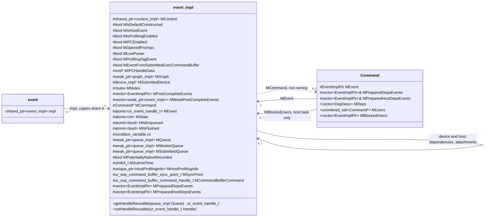
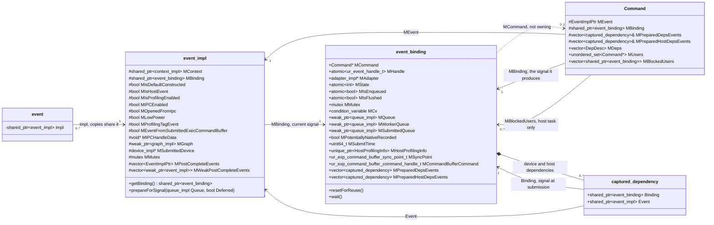
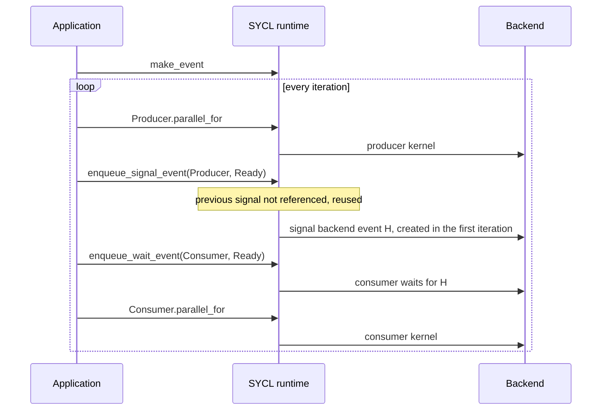
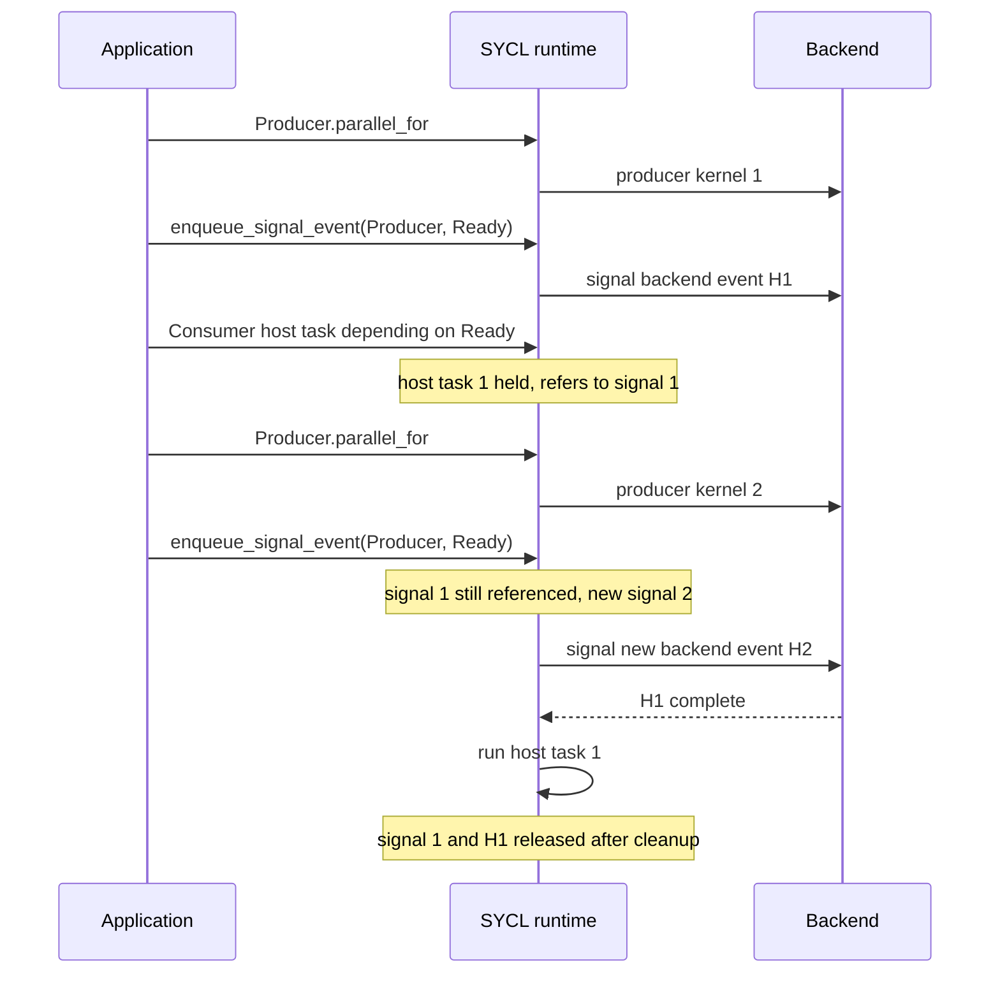

# Reusable Events

This document describes the implementation design of the
[sycl_ext_oneapi_reusable_events](../extensions/experimental/sycl_ext_oneapi_reusable_events.asciidoc)
extension.

## Overview

A reusable event can be enqueued for signaling many times, and each signal
is a separate piece of work with its own backend event, dependencies and
completion. This design separates the event, which the application holds,
from the state of one signal, so that a command that depends on the event
keeps waiting for the signal it captured, even if the event is signaled
again before the command reaches the backend.

## Problem statement

The extension says that when a command depends on a reusable event, the
dependency is captured when the command is submitted, and signaling the
event again does not change what that command waits for.

The runtime keeps one `event_impl` per event, and it holds both the identity
of the event and the state of its latest signal: the backend event, the
completion state, the producing command and its dependency lists. A command
that depends on the event stores a `shared_ptr` to that `event_impl`, and
reads the backend event from it only when it is itself submitted to the
backend. If the command is held by the runtime, for example behind a host
task, and the event is signaled again meanwhile, the command reads the new
signal:

```c++
namespace syclex = sycl::ext::oneapi::experimental;

sycl::queue Q1{sycl::property::queue::in_order{}};
sycl::queue Q2{Q1.get_context(), Q1.get_device(),
               sycl::property::queue::in_order{}};
sycl::event E = syclex::make_event(Q1.get_context());

Q1.parallel_for(N, [=](sycl::id<1> I) { A[I] = produce(I); });
syclex::enqueue_signal_event(Q1, E);            // signal 1 of E

sycl::event Gate = Q2.submit([&](sycl::handler &CGH) {
  CGH.host_task([] { waitForInput(); });        // still running
});
Q2.submit([&](sycl::handler &CGH) {
  CGH.depends_on(E);                            // must wait for signal 1
  CGH.parallel_for(N, [=](sycl::id<1> I) { consume(A[I]); });
});                                             // held behind the host task

Q1.parallel_for(N, [=](sycl::id<1> I) { A[I] = produceNext(I); });
syclex::enqueue_signal_event(Q1, E);            // signal 2, before the held
                                                // kernel reaches the backend
```

When the host task completes, the held kernel is submitted to the backend
with the backend event of signal 2, so it waits for the second producer
kernel instead of the first. With native support for reusable events the
backend event is even the same object, signaled again.

The runtime has to keep every such command waiting for the signal it
captured, whatever the reason the command is held. A command is held in the
runtime, instead of being submitted directly to the backend, when it
depends, directly or on an in-order queue through an earlier command, on:

- a host task submitted with `handler::host_task`;
- a command that accesses a memory object while a host accessor for it
  exists (`host_accessor`, `buffer::get_host_access`,
  `host_unsampled_image_accessor`, `host_sampled_image_accessor`), which is
  held until the host accessor is destroyed;
- an event from another context, which the runtime bridges through a host
  task;
- a kernel that uses `sycl::stream`, whose flush runs as a host task;
- a 2D copy or fill that the runtime performs on the host
  (`ext_oneapi_memcpy2d` and `ext_oneapi_copy2d` between host memory, and
  `ext_oneapi_fill2d` and `ext_oneapi_memset2d` when the backend has no 2D
  fill or the memory is on the host);
- the execution of an executable graph that contains host-task nodes;
- a signal of a reusable event that is itself held in the runtime;
- any other command that is held for one of these reasons.

All of these cases have to be addressed. The extension lists them today as
implementation limitations, and for a command that only depends on a
reusable event, like the kernel above, it leaves the behavior undefined.

## Event binding solution

The runtime splits an event into its identity, `event_impl`, and the state
of one signal, `event_binding`:

- `event_impl` keeps what belongs to the event as a whole: the context, the
  properties given to `make_event`, and a pointer to its current binding.
- `event_binding` holds one signal: the backend event, the completion state,
  the producing command, the dependency lists and the per-submission data.
  The command producing a signal owns the binding it writes to, so a command
  enqueued late never changes a later signal of the same event.
- A dependency is captured at submission as a `captured_dependency`, which
  names the binding that was current at that moment, whether or not it has a
  backend event yet.

Signaling the event again moves the event to a new binding, or reuses the
current one when nothing else refers to it (see Reuse of the backend event).
Either way, a captured dependency keeps waiting for its own signal: in the
example above, the held kernel captured the binding of signal 1 and waits
for it. A binding is reference counted, and its last owner releases the
backend event.

## Class diagram

### Before

Before this design, one `event_impl` per event holds both the identity and
the state of its latest signal. A signal reuses that state in place, through
`getHandleReusable` and `setHandleReusable`.



Solid arrows are owning `std::shared_ptr` references; the dashed arrow is a
non-owning raw pointer. The members of `event_impl` from `MCommand` down are
the ones that move to `event_binding`. The condition variable `cv` becomes
`MCv`, and the backend handle `MEvent` becomes `MHandle`.

### After



Solid arrows are owning `std::shared_ptr` references; the dashed arrow is a
non-owning raw pointer. `Command::MPreparedDepsEvents` and
`MPreparedHostDepsEvents` are references to the lists of the command's own
binding.

## Reuse of the backend event

`event_impl::prepareForSignal` reuses the event's current binding, together
with its backend event, only when nothing else refers to it: no command
waits for the previous signal and no queue keeps track of it. Otherwise the
event moves to a new binding with a new backend event, and the previous
binding stays valid until its last owner releases it. Reuse changes only the
number of backend events, not the results of the program.

Only a backend with native support for reusable events, such as the Level
Zero v2 adapter, can signal the same backend event again, and only for a
signal submitted directly to the backend. Without native support every
signal creates a new backend event.

The previous signal is still referenced, and the event gets a new binding,
when:
- a command that depends on it is held by the runtime (behind a host task, a
  host accessor or an event of another context), until that command has been
  submitted to the backend and cleaned up;
- the previous signal, or the command that returned the event, is itself
  held by the runtime;
- a queue still tracks it as its last command or last barrier.

### Example: a two-queue pipeline

A producer queue signals `Ready` in every iteration, and a consumer queue
waits for it. The two variants differ only in how the consumer is
submitted.

#### The event is reused: the consumer waits with `enqueue_wait_event`

```c++
namespace syclex = sycl::ext::oneapi::experimental;

sycl::queue Producer{sycl::property::queue::in_order{}};
sycl::queue Consumer{Producer.get_context(), Producer.get_device(),
                     sycl::property::queue::in_order{}};
int *Data = sycl::malloc_shared<int>(Iterations * Size, Producer);
sycl::event Ready = syclex::make_event(Producer.get_context());

for (int I = 0; I < Iterations; ++I) {
  int *Result = Data + I * Size;
  Producer.parallel_for(sycl::range<1>{Size},
                        [=](sycl::id<1> X) { Result[X] = produce(X); });
  syclex::enqueue_signal_event(Producer, Ready);
  syclex::enqueue_wait_event(Consumer, Ready);
  Consumer.parallel_for(sycl::range<1>{Size},
                        [=](sycl::id<1> X) { consume(Result[X]); });
}
Consumer.wait();
```

Every command is submitted directly to the backend, so each
`enqueue_signal_event` finds the previous signal unreferenced and reuses it.
With native support the whole loop uses one backend event.



#### The event is not reused: the consumer is a host task

```c++
for (int I = 0; I < Iterations; ++I) {
  int *Result = Data + I * Size;
  Producer.parallel_for(sycl::range<1>{Size},
                        [=](sycl::id<1> X) { Result[X] = produce(X); });
  syclex::enqueue_signal_event(Producer, Ready);
  Consumer.submit([&](sycl::handler &CGH) {
    CGH.depends_on(Ready);
    CGH.host_task([=] { consumeOnHost(Result, Size); });
  });
}
Consumer.wait();
```

The held host task refers to its signal until it has run and been cleaned
up, and the next iteration signals `Ready` before that. So every iteration
gets a new binding with a new backend event, and each host task still waits
for the signal of its own iteration.


